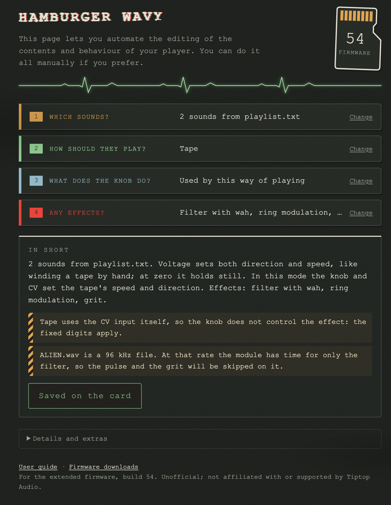

# Hamburger Wavy

THIS CUSTOM FIRMWARE FOR THE DISCONTINUED TIPTOP AUDIO ONE EURORACK MODULE IS NOT AFFILIATED WITH TIPTOP AUDIO IN ANY WAY. IF YOU USE THIS FIRMWARE, DO NOT APPROACH TIPTOP AUDIO FOR SUPPORT. THEY ARE AN AWESOME COMPANY AND DON'T NEED ANY HEADACHES CAUSED BY THIS PROJECT.

This is an unofficial sampler firmware for the Tiptop Audio ONE module, built from source for its PIC32MX170F256B. Twelve playback modes in the extended build, including gate/CV-controlled direction changes, chromatic pitch quantization, random file selection and random loop seeking. Licensed under GPLv3; see [LICENSE](LICENSE) and [NOTICE](NOTICE).

This repository contains the application, build tools, tests and documentation. No vendor firmware, boot/debug stub, extracted pitch tables or sample library is supplied. The module's existing updater is required. See [provenance](docs/provenance.md) for what was learned through reverse engineering and what is included.

## Config editor

**[Open the config editor](https://misterwavey.github.io/hamburger-wavy/)** in your browser. It builds `config.txt` and playlists from menus and sliders, explains what each choice will do, includes the user guide, and in Chrome or Edge can open your sample card to check its files, save your settings and put the current firmware on it. Nothing is uploaded; the page only contacts GitHub when you ask it to look for firmware.

It is a single file, [docs/config-editor.html](docs/config-editor.html), so you can also save it and use it offline; a copy is in each release zip.



## Download

Ready-made firmware is on the [releases page](https://github.com/misterwavey/hamburger-wavy/releases): a zip with `image.hex` for the extended build, the legacy build, the config editor and install notes, with SHA-256 checksums. Each release is tied to a tag of this source. The [config editor](https://misterwavey.github.io/hamburger-wavy/) can also fetch the current image, verify its checksum and write it to the card for you (Chrome or Edge). See [Install](#install) before updating a module.

## Build

You need Python 3.11 or newer, LLVM Clang with the MIPS backend, and LLD with ELF/MIPS support. No Python packages, proprietary SDK, XC32 compiler, vendor HEX, libc or runtime library is required. `make` is convenient but optional.

```sh
make
```

The default target retains legacy build 21 (eight modes). For current build 54 with Flip, CV Flip, Tape, Chop, Colour, Filter, phaser, flanger and tremolo/ring modulation, use:

```sh
make extended          # build/extended/image.hex
make extended-profile  # build/extended/profile/image.hex
```

Default output is `build/image.hex`, with an ELF, generated pitch tables and a build manifest alongside it. Nothing is copied to a card automatically. The builder rejects unresolved symbols, unexpected allocated sections, out-of-range code/RAM, boot-debug payload and changed hardware configuration words.

On macOS, install LLVM and LLD with Homebrew if needed. Apple's bundled Clang alone generally lacks the required target. On other systems, use an LLVM distribution with the MIPS target. Explicit tool paths are supported:

```sh
python3 tools/build.py --cc /path/to/clang --ld /path/to/ld.lld
```

The builder also accepts Rust's bundled `rust-lld` when available. To pass explicit paths through make:

```sh
make BUILD_FLAGS='--cc /path/to/clang --ld /path/to/ld.lld'
```

## Test

```sh
make test
```

Tests validate the HEX/ELF address contract, the config editor against the firmware's config parser (when Node.js is available), generated pitch mathematics, a rebuild in an isolated source tree, and the host C suite under AddressSanitizer/UndefinedBehaviorSanitizer when a suitable host compiler is available. These tests do not emulate the complete device or certify recovery from an interrupted update.

Optional original 440 Hz test WAVs can be generated with `python3 tools/generate_test_tones.py`. No audio files are included in the repository.

## Measure hardware headroom

`make profile` builds an optional diagnostic at `build/profile/image.hex`, leaving the normal image separate. It measures streaming/refill timing, observed buffer margin and stack watermark, then writes `ONEPROF.TXT` only after playback stops. See [profiling instructions and limitations](docs/profiling.md), and analyse a collected report with `python3 tools/analyze_profile.py ONEPROF.TXT`.

For the extended firmware, `make extended-profile` builds the matching diagnostic.

## Install

This is experimental replacement firmware. Preserve your existing firmware and card files separately. The application does not include the resident updater or a full recovery image. See [hardware and update limits](docs/provenance.md#hardware-and-update-limits).

Prepare a FAT16/FAT32 sample card with supported mono PCM16/24 WAVs. Copy the built image to its root as `image.hex`, verify it, then eject. Example for current extended build 54 on a macOS volume named TTA ONE (run `make extended` first):

```sh
cp build/extended/image.hex "/Volumes/TTA ONE/image.hex"
sync
cmp build/extended/image.hex "/Volumes/TTA ONE/image.hex"
diskutil eject "/Volumes/TTA ONE"
```

Use the [manufacturer's update procedure](https://www.tiptopaudio.com/manuals/Tiptop_Audio_one.pdf): power down, insert the card, hold PLAY while powering up, and allow the updater's rapid flashing to complete. The application then starts. Do not interrupt updating.

At startup, the PLAY button lights blue for one second. The firmware writes its build number to `ONEBUILD.TXT` on the SD card, which you can read on your computer to check which version is installed. If the file cannot be written, playback can still start.

## Use

PLAY taps trigger; FILE browses. Hold PLAY for at least 400 ms before turning FILE to edit the playback mode, or moving pitch to edit the CV mode. Stop turning and keep PLAY held to read complete red/blue pulse groups; release to apply. A card's `config.txt` is reloaded at each mount.

See [the user guide](docs/user-guide.md) for modes, configuration, playlists, SD writes and quantization. Examples are in `examples/config/`.

## Features of the extended build

- **Playback modes 9–12:** [Flip](docs/flip.md) reverses direction on each gate; [CV Flip](docs/cv-flip.md) takes direction from bipolar CV; [Tape](docs/tape.md) gives signed speed with a hold at zero; [Chop](docs/chop.md) jumps to a CV-selected position on each gate.
- **Effects**, set by lines in `config.txt`: [drive and crush](docs/colour.md); a resonant [filter](docs/filter.md) with low-pass, high-pass and band-pass outputs and an automatic wah sweep; a [phaser](docs/phaser.md) or [flanger](docs/flanger.md); and [tremolo and ring modulation](docs/mod.md). The pitch knob/CV can be assigned to an effect amount, the filter cutoff or the modulation speed.
- Several playlist files on one card, with a `Playlist name` line in `config.txt` choosing the one in use, and playlist entries that use files' full names (up to 63 characters).
- A FILE encoder reader that tolerates worn or chattering contacts, and one automatic retry of a failed card read.

The [user guide](docs/user-guide.md#effects) lists every effect line, the rate scales and how many effects can run at each playback rate. The [config editor](https://misterwavey.github.io/hamburger-wavy/), a single web page that also works offline, builds `config.txt` and playlists from menus and sliders, explains what each choice will do, and can check the files on the card.

## Status

This is experimental firmware developed and tested on a single module with a small set of cards and files. The legacy build 21 and the extended build have both run on that hardware across their playback modes and effects, including sustained 96 kHz/24-bit playback, with the diagnostic build recording no streaming errors in those runs. A complete matrix of modes, cards, sample rates and modulation speeds has not been tested, and the phaser and flanger are newer than the rest. Timing margins are tightest for 88.2/96 kHz files; see the limits in the user guide.

Hamburger Wavy is independent of Tiptop Audio and is not endorsed by the manufacturer. Hardware/product names identify compatibility. See [provenance](docs/provenance.md) for what is included and how it was derived.
